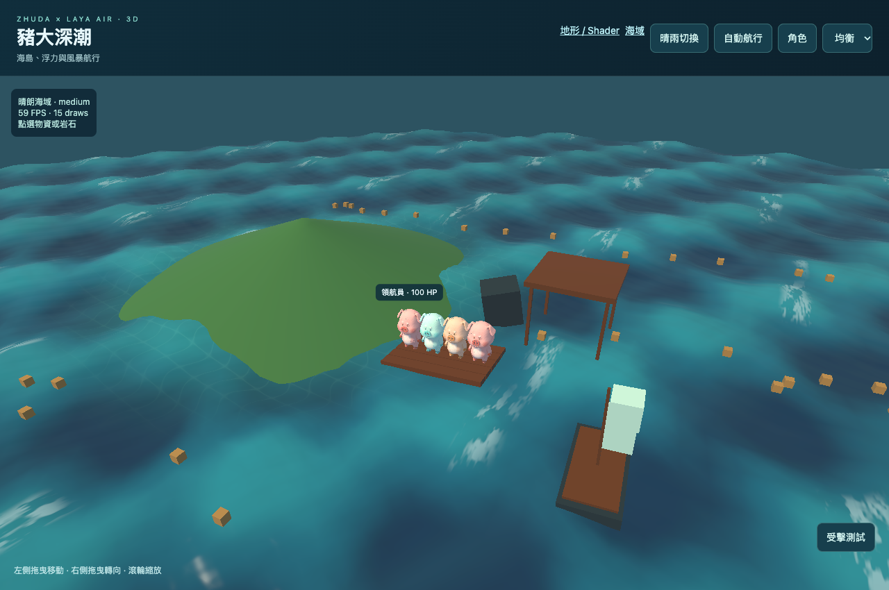

# 豬大深潮 · 3D 接入驗收

[開啟場景](https://zhudaandzhuer.github.io/zhuda-3d-lab/) · [引擎](https://github.com/zhudaandzhuer/zhuda-laya-engine)

獨立消費專案，驗證 zhuda-laya-engine 的 3D 接入。具備海島、水面、浮動木筏／小船、豬大模型、物資實例、晴雨切換與隔離模型預覽。這是引擎驗收切片，完整《深潮求生》的勝負、建造、網路與存檔規則尚未搬入。



## 執行

Node.js 24+；引擎依賴固定到 Git commit，沒有 sibling checkout 或 TypeScript paths 依賴。

```sh
npm ci
npm run typecheck
npm run build
npm start
```

開啟 `http://localhost:8914/`。左側拖曳移動、右側拖曳轉向、滾輪縮放；頂部可切換天氣、航行、角色預覽與畫質。`?sandbox=1` 在 opaque-origin iframe 執行；`?route=1&quality=low` 開啟自動航行。

地形／shader 驗收頁使用 `?terrain=1`（可加 `&quality=low&route=1`）。它同時建立 2D tile chunks 和 3D heightfield chunks；可切換圖塊筆刷／抬高地形、LOD 1→2→4、atlas tint 與 dissolve shader。畫面中的 cell ID、chunk 數、LOD、raycast 與 shader pixel 變化都由真實 SDK 呼叫產生，並不是靜態展示。

```sh
npm test
# 非 macOS 可設定 CHROME_PATH 指向 Chromium/Chrome 執行檔
# 指定已啟動的根路徑或正式站：
GAME_URL=http://localhost:8914/ npm test
```

正式 Pages 網址另通過同一套 20 項檢查，見 `evidence/production-report.json`；根路徑與 repository subpath 的報告也分別保存。

測試會啟動 localhost:8915 的 repository subpath，透過 Chrome CDP 操作真實 WebGL。報告寫到 `evidence/browser-report.json`，測試失敗會保留 partial report。CI 在 Linux Chrome 執行 typecheck／build／browser test。

## 資產來源與邊界

`asset-inventory.json` 列出來源、SHA256、bytes、GLB 結構與外部 JPG。三款模型來自使用者的《豬大探索世界》Blender 豬大資產，保留作者與原有權利；本 repo 的程式授權不重新授權這些美術資產。模型實際格式為 GLB2，發布副檔名為 `.bin`。三款均沒有 animation clips，因此本結果不代表已驗證全部骨骼動畫。

`src/WaveField.js` 與 `src/OceanShader.js` 由原遊戲波浪／海面呈現接入，屬於消費專案。引擎只提供自訂 shader、網格與採樣器契約，不擁有波浪或遊戲規則。原遊戲來源未修改。

## 已保存驗證

- GPU transform feedback：同一份 WAVE_GLSL，四個時間共 256 點；最大高度差約 0.012 mm。這是波浪函式採樣，非整張畫面的逐像素一致。
- 模型／場景反覆建立與釋放 30 次，資源數保持有界；共享 JPG 仍有效，一個角色受擊不改變另一個同皮膚角色。
- 實際 depth／opaque camera pass 與低畫質預算拒絕；動態 buffer 更新／bounds、屋頂擋雨、DPR 1／2／3、橫豎屏 CSS 座標、雙指取消／放開、iframe 預覽拆除、WebGL context loss 還原及 opaque sandbox。
- 最新固定版另以 iPhone 剪貼簿貼入 URL，實體觸控驗證拖曳／放開與受擊按鈕；同皮膚另一角色保持原色，見 `evidence/iphone14-input-check.json`／PNG。
- `evidence/iphone14-10min.json`：iPhone 14 Safari 27.0.1，low、DPR 1，614.525 秒有效採樣，36,545 frames；P50 17 ms、P95 20 ms、P99 24 ms，>50 ms 長幀 0。採樣期間自動航行及每 45 秒晴雨交替。
- `evidence/terrain-report.json`：terrain／shader 的真實 WebGL 回歸，包含 2D atlas UV／tint／透明度／clipping，3D textured／fog／dissolve，跨 chunk 編輯、LOD、世界距離上限、30 次拆除、context loss 和 opaque sandbox。故意錯誤的 GLSL 另保留預期 compile diagnostic。
- `evidence/terrain-mobile-acceptance.json`：iPhone 14 與 vivo V40 各保存 72,000 筆最近 frame interval，約 20 分鐘樣本；low／DPR1，每 30 個 active 秒切換 2D／3D，帶 camera orbit／map scroll 與 dissolve 動畫。P95 分別 22 ms／19.6 ms，P99 23 ms／21.6 ms；>50 ms 分別 4／85 幀。超過五秒的中斷未納入統計，這不是不中斷的壓測；`modeFrames` 是整個 session 累計，和 rolling sample 的 `frames` 範圍不同。
- iPhone 以剪貼簿輸入 URL，實機 LOD 按鈕操作後由 1 變 2；雙平台 2D／3D 畫面均已目視確認，截圖保存在 evidence。手機執行的是最終 ray distance 整理前的相同 rendering 切片；固定最終 Git SHA 另外通過桌面回歸。

海域手機負載固定為 4 角色、1 木筏、1 船、1 雨棚、48 物資與最多 160 雨滴；不是百人完整地圖。地形測試固定為 4 heightfield chunks（LOD1 時共 4,356 vertices）、2D 視野 chunks、4 shader fixture cubes。GPU 時間未量測，資源容量是估算；記錄中的 vendor gpuBytesEstimated 也不是 driver measurement。

`?id=<run>&route=1&quality=low` 僅供 LAN server 每 15 秒接收 `/telemetry`。正式 Pages 無 telemetry 後端，公開網址省略 id。

完整兩種模式、密集戰鬥／決勝、263 項遊戲測試分類、Android 10 分鐘與正式站部署驗收仍由遊戲移植階段完成。
